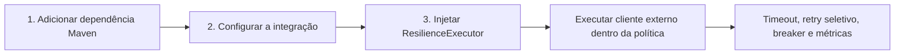
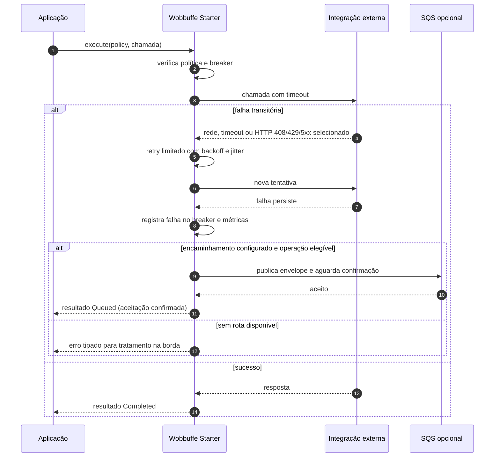
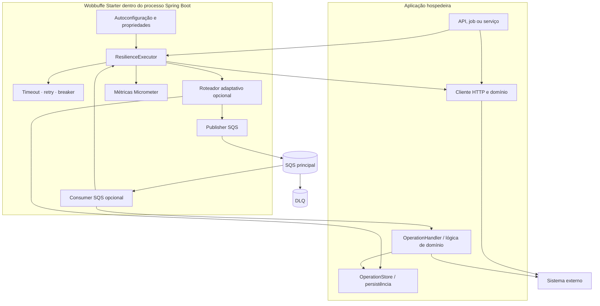

# Wobbuffe Starter — apresentação executiva

**Biblioteca reutilizável para resiliência em integrações externas**  
Material para apresentação à liderança · 9 de outubro de 2026

## Mensagem principal

O Wobbuffe Starter concentra políticas comuns de resiliência em uma biblioteca Spring Boot. Cada aplicação continua dona do seu domínio e do cliente externo, enquanto timeout, classificação de falhas, retry, circuit breaker, métricas e, quando configurado, encaminhamento e consumo assíncronos ficam em um único componente reutilizável.

A adoção básica é pequena: adicionar a dependência, declarar um identificador estável para a integração e executar a chamada através do `ResilienceExecutor`. A aplicação não precisa construir sua própria implementação de retry ou circuit breaker.

## Como uma aplicação adota a biblioteca



Exemplo mínimo de chamada:

```java
ResilienceResult<Pokemon> result = resilienceExecutor.execute(
    properties.policyFor("pokeapi"),
    () -> pokeApiClient.findByName(name)
);
```

Exemplo de configuração, com valores ajustáveis por integração:

```yaml
wobbuffe:
  enabled: true
  defaults:
    timeout: 2s
    max-attempts: 3
    initial-backoff: 200ms
    failure-rate-threshold: 50
    minimum-calls: 10
  integrations:
    pokeapi:
      enabled: true
      async-eligible: true
```

O identificador `pokeapi` deve ser estável. A API programática é a forma recomendada quando a aplicação precisa lidar com o resultado ou habilitar roteamento. `@ResilientIntegration` é uma alternativa opcional para chamadas síncronas em aplicações que usam Spring AOP.

## O que acontece durante uma falha



O retry é seletivo e limitado. Erros permanentes não são repetidos. Se o breaker estiver aberto e não houver caminho assíncrono disponível, o starter falha rapidamente com um erro tipado; a aplicação escolhe como apresentar esse erro ao cliente.

## Arquitetura e responsabilidades



| Responsabilidade | Starter | Aplicação hospedeira |
| --- | --- | --- |
| Timeout, retry, classificação, breaker e métricas | Implementa | Configura os valores e traduz erros na borda |
| Cliente HTTP e credenciais do upstream | — | Implementa e configura |
| Seleção de integrações elegíveis e configuração | Fornece os mecanismos | Decide por integração |
| Publicação e consumo SQS | Fornece componentes opcionais | Configura filas e o AWS SDK |
| Idempotência durável e persistência de domínio | Define a SPI `OperationStore` | Implementa |
| Tratamento de uma operação de domínio | Define `OperationHandler` | Implementa |

O starter não é um serviço separado. Ele roda no processo da aplicação hospedeira e não substitui seu cliente HTTP, banco, lógica de negócio ou monitoramento.

## Benefícios que a demonstração permite observar

- **Menos mecanismos duplicados:** políticas comuns ficam configuradas em um lugar para as integrações que adotam a biblioteca.
- **Falha mais rápida e explícita:** circuit breaker impede continuar acumulando chamadas lentas ou falhas quando o limite configurado é atingido.
- **Retry controlado:** apenas classes de erro transitórias recebem novas tentativas, com limite, atraso e jitter configuráveis.
- **Caminho assíncrono opcional:** integrações elegíveis podem encaminhar trabalho para SQS quando a degradação é detectada; `202` só significa aceitação depois da confirmação da fila.
- **Instrumentação comum:** métricas Micrometer registram eventos de execução, breaker, roteamento e fila sem colocar IDs de operação ou correlação como tags de alta cardinalidade.
- **Integração incremental:** uma aplicação pode começar com chamadas síncronas protegidas e habilitar SQS apenas para os casos que suportam execução assíncrona.

Esses benefícios descrevem mecanismos presentes no código. Este material não atribui percentuais de redução de incidentes, economia ou aumento de disponibilidade sem medições de produção.

## Evidências da demo

Na validação local de 9 de outubro de 2026:

- A API demo usa a PokéAPI pública real para importação; os testes automatizados isolam o upstream com WireMock.
- O caminho assíncrono foi exercitado com a API e LocalStack: uma importação recebeu `202 QUEUED`, foi processada pelo consumer integrado ao starter, terminou `SUCCEEDED` e salvou o resultado no H2 da demo.
- A fila principal estava vazia depois do processamento. O ambiente local fornece fila principal e DLQ via LocalStack.
- Os testes de integração da API passaram. Os testes do starter executados passaram; dois testes que dependem de Testcontainers/Docker foram ignorados no ambiente quando o socket Docker não esteve acessível.

Essa evidência valida o fluxo demonstrativo, não um SLA de produção. A demo usa H2 em memória e perde registros após reinício.

## Limites e decisões para produção

1. **Persistência:** a aplicação precisa implementar `OperationStore` com armazenamento durável para recuperação real. H2 em memória é somente demonstrativo.
2. **Consistência:** não há outbox nem transação distribuída entre o banco da aplicação e SQS. Falhas em pontos intermediários podem deixar pendências ou respostas ambíguas.
3. **Entrega:** SQS entrega ao menos uma vez. Handlers precisam suportar repetição e usar idempotência.
4. **Timeout:** cancelamento tenta interromper a tarefa, mas não garante que I/O bloqueante pare. O cliente HTTP também deve ter timeout de conexão e leitura.
5. **Operação:** valores padrão precisam ser ajustados e observados para o perfil de tráfego e o upstream de cada aplicação. A biblioteca melhora a disciplina de falha; não garante disponibilidade do sistema externo.

## Caminho de adoção sugerido

1. Selecionar uma integração externa de baixo risco e adicionar o starter.
2. Começar com `ResilienceExecutor`, timeout, retry e breaker; mapear as exceções do cliente HTTP para a classificação do starter.
3. Conferir métricas e calibrar limites com telemetria do ambiente.
4. Habilitar roteamento somente para operações que possam ser processadas depois e que tenham contrato idempotente.
5. Antes de produção assíncrona, implementar `OperationStore` durável, desenhar recuperação de pendências e validar redelivery/DLQ.

## Materiais relacionados

- [README de uso e configuração](../README.md)
- [Arquitetura detalhada e diagramas](architecture.md)
- [Decisões de arquitetura](decisions.md)

