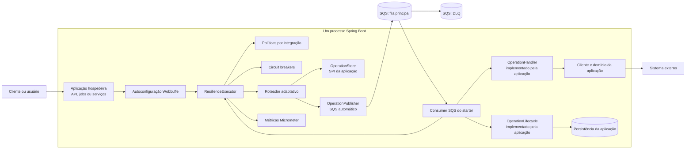
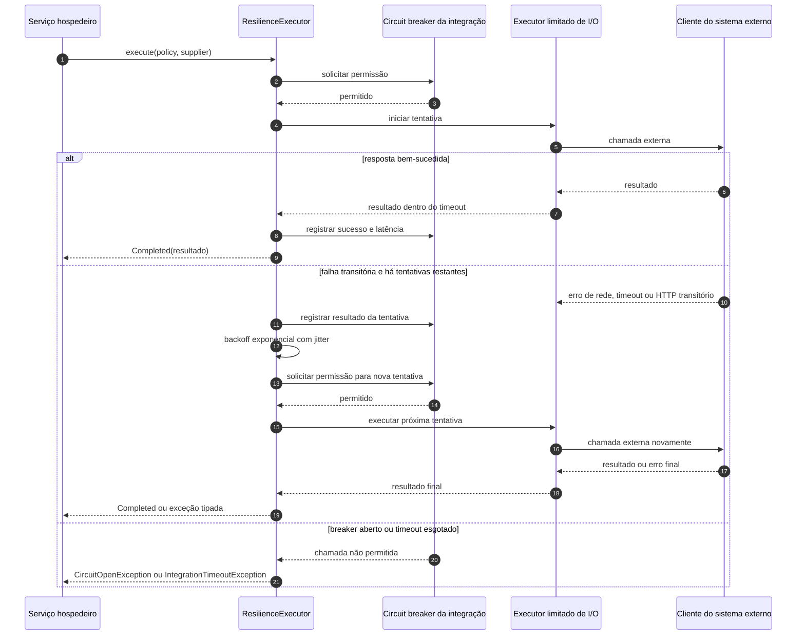
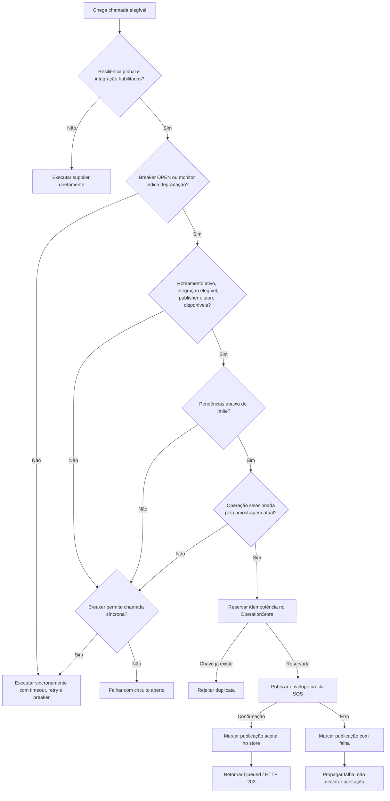
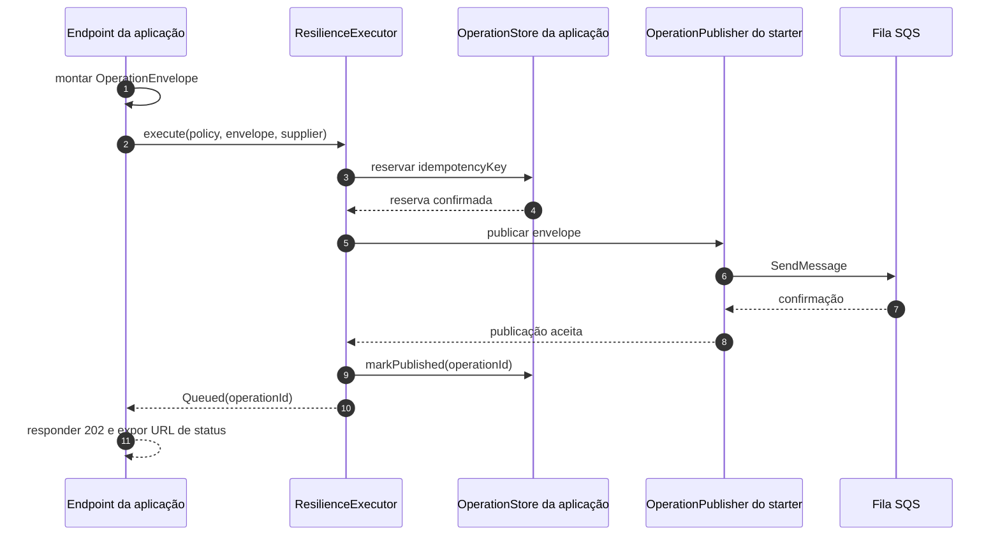
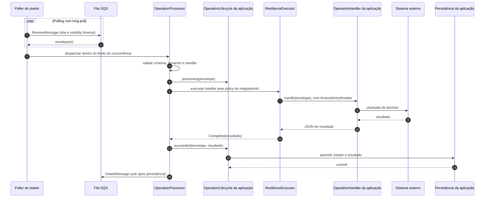
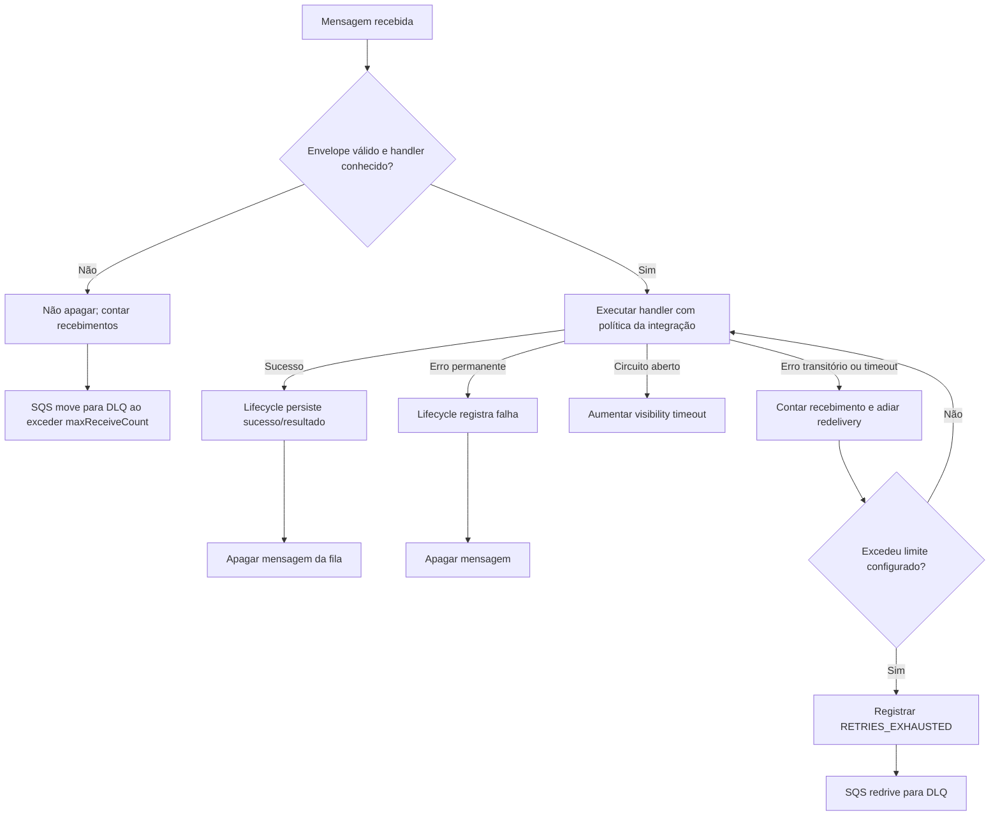
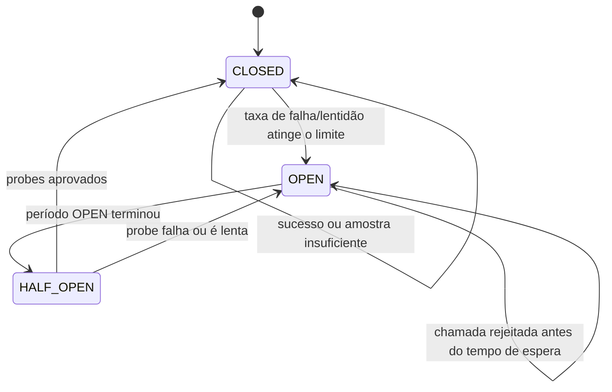

# Arquitetura do Wobbuffe Starter

Este documento descreve os limites arquiteturais do starter e o caminho que uma chamada percorre nos modos síncrono e assíncrono. O desenho representa o estado atual do código: o starter contém os mecanismos genéricos de resiliência; a aplicação hospedeira contém os clientes e handlers do seu domínio e os adaptadores para persistência.

## Visão de sistema

O starter é uma biblioteca carregada dentro do processo Spring Boot da aplicação. Não é um serviço independente e não cria um banco próprio. Quando SQS está configurado, o mesmo processo pode publicar e, opcionalmente, consumir mensagens.

### Limites dos componentes

- **Wobbuffe Starter:** carrega as propriedades, constrói políticas, executa chamadas protegidas, decide se uma operação elegível pode ser encaminhada, publica e consome envelopes SQS, aplica limites de concorrência e taxa, agenda redelivery e registra métricas.
- **Aplicação hospedeira:** escolhe quais integrações usar, configura endpoints e credenciais, adapta exceções do cliente HTTP, fornece handlers de domínio, fornece `OperationStore` para roteamento e pode fornecer `OperationLifecycle` para atualizar status e persistir resultados.
- **SQS:** armazena temporariamente mensagens e entrega pelo menos uma vez. A redrive policy da fila principal controla a transferência para a DLQ.
- **Sistema externo:** é chamado pelo código da aplicação dentro do executor do starter. A biblioteca não substitui nem simula o sistema externo.

## Chamada síncrona

`ResilienceExecutor.execute(policy, supplier)` é a fronteira programática. O starter verifica se a política está ativa, seleciona o circuit breaker da integração e executa cada tentativa com timeout. Falhas classificadas como transitórias podem ser repetidas até o limite configurado.

O timeout cancela a espera e tenta interromper a tarefa. Clientes de I/O bloqueantes podem não parar ao receber uma interrupção; a aplicação também deve configurar timeout de conexão e leitura no cliente HTTP.

## Decisão de execução ou encaminhamento

O roteamento adaptativo é desligado por padrão. Quando ligado, só se aplica a uma integração configurada com `async-eligible: true`, e o encaminhamento ainda depende de degradação, amostragem, capacidade, `OperationStore` e confirmação do publisher.

O monitor avalia uma janela de latência e falhas com número mínimo de amostras. A amostragem inicia em 5%, sobe em passos de 5 pontos percentuais até `max-percent` durante degradação e diminui após janelas saudáveis. Mesmo com rota habilitada, chamadas saudáveis normalmente seguem pelo caminho síncrono.

`enqueue(policy, envelope)` é diferente: ele solicita enfileiramento imediato e falha explicitamente se a rota não estiver pronta, a integração não for elegível, o limite de pendências for atingido, a chave idempotente já existir ou o envio falhar.

## Publicação e consistência

O envelope inclui versão do schema, IDs de operação e integração, instante de criação, chave idempotente, payload JSON e correlation ID. Ele deve conter apenas o necessário ao handler e permanecer pequeno e sem dados sensíveis.

O store e SQS não participam da mesma transação. Uma queda entre a reserva e o envio pode deixar uma operação pendente; uma resposta ambígua de rede pode causar reentrega. O starter registra falha de publicação quando consegue observar o erro, mas não fornece outbox. A chave idempotente e um store transacional reduzem duplicação; não substituem handlers seguros para repetição.

## Consumo de uma operação

O consumer é criado apenas com `wobbuffe.consumer.enabled=true`, AWS SDK SQS no classpath e URL de fila configurada. A autoconfiguração registra o polling, o executor limitado, o rate limiter, o processador e as métricas da fila.

O `OperationHandler` contém a operação de domínio. O starter aplica a política em torno do handler; não coloque uma segunda camada de retry/circuit breaker no handler. `OperationLifecycle` é opcional: sem implementação da aplicação, o consumer processa e confirma a mensagem sem persistir estados de negócio.

### Falhas no consumer

O limite local `max-receive-count` deve ser igual ao `maxReceiveCount` da redrive policy da fila. Configure o visibility timeout para cobrir o tempo total do handler, incluindo tentativas e backoffs. Falhas de polling são medidas e o scheduler tenta novamente no próximo ciclo.

## Estados do circuit breaker

O breaker é isolado por `integrationId`. Ele usa uma janela temporal, mínimo de chamadas, limites de falha e de chamadas lentas; depois de esperar em `OPEN`, permite um número limitado de probes em `HALF_OPEN`.

O monitor de degradação e o circuit breaker se complementam. O breaker decide se uma tentativa síncrona pode começar; o monitor calcula saúde recente e informa o roteamento adaptativo.

## O que a aplicação precisa fornecer

- Um `OperationStore` para usar roteamento assíncrono; ele reserva idempotência, informa pendências e atualiza publicação.
- Um ou mais beans `OperationHandler` para tipos de operação consumidos.
- Um `OperationLifecycle` quando estados/resultados precisarem ser gravados no banco da aplicação.
- Cliente HTTP/RPC de domínio com timeout de rede e adaptação de exceções para classificação.
- Fila principal e DLQ com redrive policy compatível; credenciais vêm da cadeia padrão do AWS SDK ou do secret manager da plataforma.

O starter não exige SQS para execução síncrona. Sem URL de fila, não cria publisher SQS. Sem `consumer.enabled`, não inicia polling.

## Implementação de referência neste repositório

Na aplicação demo, a API mantém o handler Pokémon e o adaptador JPA. A API instancia o envelope com o nome Pokémon, enquanto o starter aceita a publicação, consome a mensagem e envolve o handler com a política `pokeapi`. O adaptador da API atualiza `PROCESSING`, salva o Pokémon e marca `SUCCEEDED`. O LocalStack fornece fila e DLQ. H2 em memória é somente armazenamento de demonstração e perde os dados ao reiniciar a API.

Veja [a configuração da API](../../wobbuffe-api/src/main/resources/application.yml), [o handler Pokémon](../../wobbuffe-api/src/main/java/com/wobbuffe/api/operation/PokemonImportOperationHandler.java) e [o adaptador de ciclo de vida](../../wobbuffe-api/src/main/java/com/wobbuffe/api/operation/ApiOperationLifecycle.java) para a implementação concreta.
